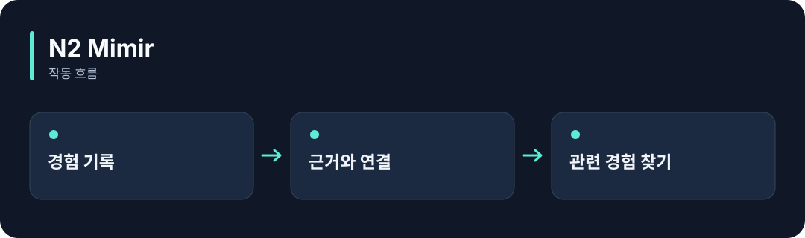

# N2 Mimir

**AI가 해본 일과 그 결과를 모아, 다음 작업에 참고할 경험을 찾아줍니다.**

[](https://github.com/choihyunsus/n2-mimir/releases/tag/v3.0.3) [](https://github.com/choihyunsus/n2-mimir/blob/main/docs/reference.ko.md) [](https://github.com/choihyunsus/n2-mimir/blob/main/LICENSE)

[English](README.md)



## 이런 때 사용하세요

같은 실수를 반복하는 작업이나, 이전에 어떤 방법이 효과가 있었는지 되짚어야 하는 앱에 연결하세요.

여기서 학습은 경험과 참고 내용을 저장하고 찾아 쓰는 과정입니다. 모델에 전달할 내용과 실제 결과의 타당성은 연결한 앱이 판단합니다.

## 처음 실행하기

터미널에서 `node --version`을 실행해 Node.js 22 이상인지 확인하세요. 아래 명령은 새 연습 폴더를 만들고 GitHub 배포 파일을 설치합니다. 예제 파일과 DB도 이 폴더에 두면 경로를 따라가기 쉽습니다.

```sh
mkdir n2-mimir-demo
cd n2-mimir-demo
npm init -y
npm install https://github.com/choihyunsus/n2-mimir/releases/download/v3.0.3/n2-mimir-3.0.3.tgz
```

설치 중 SQLite 빌드 오류가 나오면 운영체제에 맞는 C/C++ 빌드 도구가 필요할 수 있습니다. 자세한 환경 조건은 [설치 참고](https://github.com/choihyunsus/n2-mimir/blob/main/docs/reference.ko.md)에 있습니다.

아래 내용을 `demo.mjs`로 저장하세요. 파일은 방금 설치 명령을 실행한 폴더에 둡니다.

```js
import { MimirDatabase } from 'n2-mimir/storage';
const memory = new MimirDatabase('./demo.db');
try {
  const saved = memory.insertExperience({
    project: 'demo', agent: 'assistant', type: 'pattern',
    category: 'notes', context: 'First memory',
    action: 'Save a note', outcome: 'Remember to check the tests',
  });
  console.log(memory.getExperience(saved.id).outcome);
} finally {
  memory.close();
}
```

```sh
node demo.mjs
```

`Remember to check the tests`가 출력되고 `demo.db`에 기록이 저장됩니다.

## Soul과 함께 쓰기

여러 N2 모듈을 연결할 때 같은 `mimir.db` 파일을 지정하세요. `project`는 작업 이름, `agent`는 계속 사용할 AI 이름입니다. 같은 작업의 기록을 이어 쓰려면 이 값들을 맞춥니다. 단독 사용도 같은 필드 구조를 사용합니다.

## 다음 단계와 상세 안내

[전체 사용 안내](https://github.com/choihyunsus/n2-mimir/blob/main/docs/reference.ko.md)에서 실제 앱 연결, API, 지원 범위, 복구 절차와 검증 범위를 확인할 수 있습니다. [배포 파일](https://github.com/choihyunsus/n2-mimir/releases/tag/v3.0.3)에는 설치할 버전과 변경 설명이 있습니다.

처음 나오는 용어는 이렇게 읽으면 됩니다. **MCP**는 AI 앱의 도구 연결 방식, **DB**는 저장 파일, **호스트**는 이 모듈을 연결해 실행하는 앱입니다.

사용·재배포 조건은 [라이선스](https://github.com/choihyunsus/n2-mimir/blob/main/LICENSE)를 확인하세요. 의존 모듈에는 별도 조건이 적용될 수 있으며, 상업 이용 조건은 상세 안내에 함께 설명되어 있습니다.
