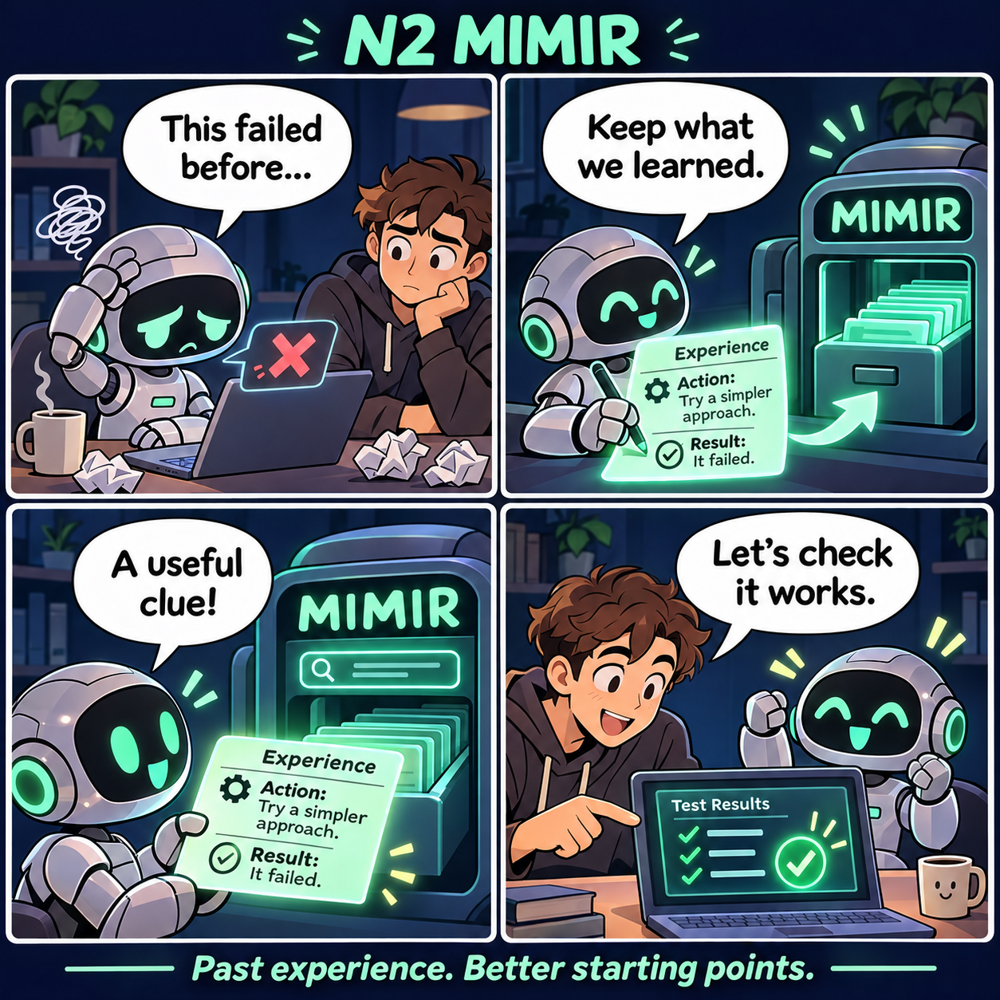
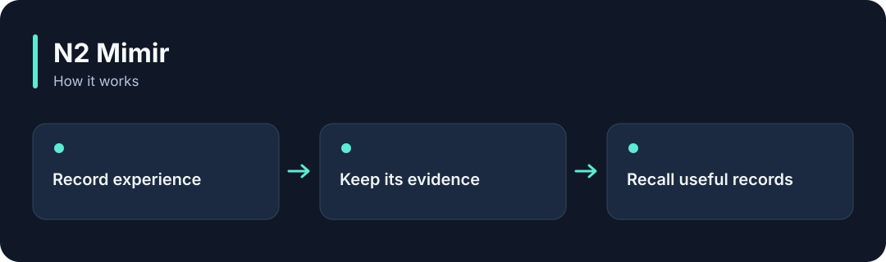

# N2 Mimir

**Keep a record of what an AI tried and what happened, then find useful experience for the next task.**

[](https://github.com/choihyunsus/n2-mimir/releases/tag/v3.0.3) [](https://github.com/choihyunsus/n2-mimir/blob/main/docs/reference.md) [](https://github.com/choihyunsus/n2-mimir/blob/main/LICENSE)

[한국어](README.ko.md)

<p align="center">
  
</p>

Keep a record of what an AI tried and what happened, then find useful experience for the next task.

A story illustrating the feature, rather than a screenshot of the app.

<details>
<summary>View the workflow</summary>



</details>

## When to use it

Connect it to an app that needs to revisit past mistakes or find approaches that worked before.

Learning here means saving and reusing experience and guidance. The connected app decides what to pass to the model and checks whether the result is valid.

## Try it

Run `node --version` in a terminal and check for Node.js 22 or later. These commands create a fresh practice folder and install the GitHub release. Keep the example file and database in this folder.

```sh
mkdir n2-mimir-demo
cd n2-mimir-demo
npm init -y
npm install https://github.com/choihyunsus/n2-mimir/releases/download/v3.0.3/n2-mimir-3.0.3.tgz
```

If installation reports a SQLite build error, you may need your platform’s C/C++ build tools. See the [installation reference](https://github.com/choihyunsus/n2-mimir/blob/main/docs/reference.md) for platform requirements.

Save the following as `demo.mjs` in the folder where you ran the install command.

```js
import { MimirDatabase } from 'n2-mimir/storage';
const memory = new MimirDatabase('./demo.db');
try {
  const saved = memory.insertExperience({
    project: 'demo', agent: 'assistant', type: 'pattern',
    category: 'notes', context: 'First memory',
    action: 'Save a note', outcome: 'Remember to check the tests',
  });
  console.log(memory.getExperience(saved.id).outcome);
} finally {
  memory.close();
}
```

```sh
node demo.mjs
```

`Remember to check the tests` appears and the record is stored in `demo.db`.

## Using it with Soul

Point connected N2 modules at the same `mimir.db` file. `project` names the work and `agent` names the AI identity you will keep using. Match those values to continue working with the same records. Standalone use follows the same field layout.

## Next steps and reference

The [full reference](https://github.com/choihyunsus/n2-mimir/blob/main/docs/reference.md) covers app integration, APIs, supported features, recovery and validation. The [release page](https://github.com/choihyunsus/n2-mimir/releases/tag/v3.0.3) contains the installable version and release notes.

A few terms used in the reference: **MCP** connects tools to an AI app, a **database** stores records, and the **host** is the app that connects and runs this module.

Review the [license](https://github.com/choihyunsus/n2-mimir/blob/main/LICENSE) for use and redistribution. Dependencies can have their own terms, including commercial-use conditions described in the reference.
